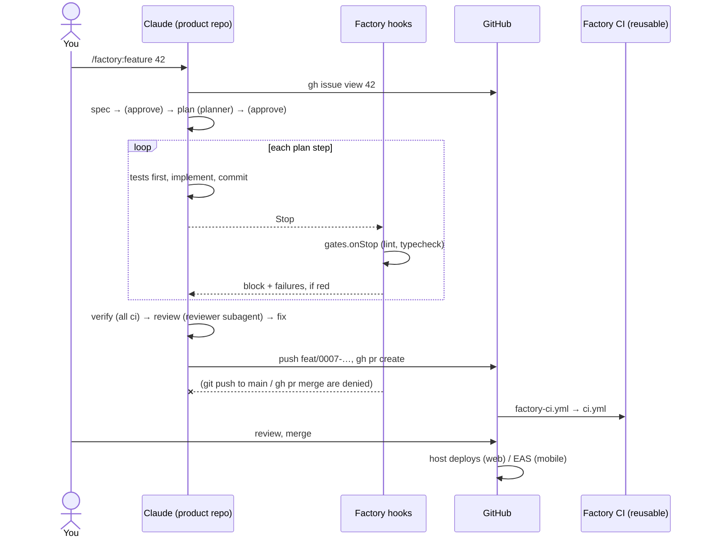

# Architecture

## Two kinds of repos

**The factory (this repo)** is the control plane. It holds no product code.

```
software-factory/
├── .claude-plugin/marketplace.json   # this repo is a Claude Code plugin marketplace
├── plugins/
│   ├── factory/                      # core: pipeline skills, agents, guardrail hooks (every product)
│   ├── factory-web/                  # web skills: audit, e2e
│   └── factory-mobile/               # mobile skills: release, ota
├── .github/workflows/                # reusable workflows products call (on: workflow_call)
│   ├── ci.yml                        #   runs .factory/product.json → ci
│   ├── claude-agent.yml              #   @claude / `claude` label → Claude Code action
│   ├── claude-review.yml             #   opt-in Claude PR review
│   ├── mobile-eas.yml                #   EAS Update previews, OTA, store-release workflow
│   └── factory-self-check.yml        #   CI for the factory itself (not reusable)
├── templates/
│   ├── common/{seed,managed,merge}/  # files every product gets
│   ├── web/{template.json,managed,merge}/
│   └── mobile/{template.json,seed,managed,merge}/
├── registry/products.json            # the fleet
├── scripts/factory.mjs               # fleet CLI (zero dependencies)
├── .claude/skills/                   # operator skills for working IN the factory: /new-product, /fleet-sync…
├── factory.config.json               # factory repo, ref, marketplace name, dirs
└── docs/
```

**Each product repo** keeps its own code, plus a thin layer from the factory:

```
acme-site/
├── CLAUDE.md                          # seed: product-owned; imports @.factory/standards.md
├── .factory/
│   ├── product.json                   # the product contract (product-owned; sync only adds missing keys)
│   ├── standards.md                   # managed: factory-wide engineering standards
│   └── managed.json                   # managed: list of managed files (the protect-files hook reads it)
├── .claude/settings.json              # merge: factory marketplace + plugins + baseline permissions
├── .github/
│   ├── workflows/factory-ci.yml       # managed: calls factory ci.yml (+ mobile-eas.yml for apps)
│   ├── workflows/factory-claude.yml   # managed: calls factory claude-agent.yml
│   ├── workflows/factory-claude-review.yml  # managed: calls factory claude-review.yml
│   ├── ISSUE_TEMPLATE/{feature,bug}.yml     # managed
│   └── pull_request_template.md       # managed
├── docs/specs/                        # seed: specs + plans written by /factory:spec and /factory:plan
└── eas.json, .eas/workflows/release.yml   # seed (mobile only)
```

## File ownership: seed, managed, merge

The question every multi-repo setup has to answer is who owns each file. Here it's explicit:

| Mode             | Created       | On `factory sync`                                             | Owner       | Examples                                            |
| ---------------- | ------------- | ------------------------------------------------------------- | ----------- | --------------------------------------------------- |
| **seed**         | if missing    | never touched                                                 | the product | `CLAUDE.md`, `eas.json`, `docs/specs/README.md`     |
| **managed**      | always        | overwritten                                                   | the factory | standards, workflow callers, issue and PR templates |
| **merge** (JSON) | if missing    | deep-merged: objects merge, arrays union, factory scalars win | shared      | `.claude/settings.json`                             |
| manifest         | `new`/`adopt` | missing keys added, existing values kept                      | the product | `.factory/product.json`                             |

Managed files are listed in `.factory/managed.json`. The core plugin's `protect-files` hook refuses
Claude edits to them inside products. To change one, edit its template in the factory and run sync.

## Three distribution channels

### 1. Claude behaviour → plugins

The factory repo is a plugin marketplace (`.claude-plugin/marketplace.json`). Each product's committed
`.claude/settings.json` declares it:

```json
{
  "extraKnownMarketplaces": {
    "software-factory": {
      "source": { "source": "github", "repo": "OWNER/software-factory" }
    }
  },
  "enabledPlugins": {
    "factory@software-factory": true,
    "factory-web@software-factory": true
  }
}
```

When you open a product in Claude Code and trust the folder, it offers to install the marketplace and
plugins. After that, skills are namespaced (`/factory:feature`, `/factory-web:audit`), subagents
(`planner`, `reviewer`, `test-writer`) are available, and the hooks are active.

- **Updates:** auto-update is off by default for non-Anthropic marketplaces. After you change a plugin,
  **bump its `version`** in `plugin.json`, then run `claude plugin marketplace update software-factory`
  (or `/plugin`). In CI, the action installs fresh on every run.
- **Why plugins and not per-repo `.claude/` copies:** one source of truth, versioned, no drift, and
  hooks ship alongside the skills that depend on them.

### 2. CI → reusable workflows

Product workflows are short callers:

```yaml
jobs:
  checks:
    uses: "OWNER/software-factory/.github/workflows/ci.yml@main"
```

The reusable workflow reads `.factory/product.json`, so the same YAML serves Next.js, Astro, Expo,
pnpm or npm. Pin `@v1` (a tag) instead of `@main` once you're stable. See [07-customizing.md](07-customizing.md#versioning-and-rollout).

### 3. Files → templates + sync PRs

`factory sync` clones each product into `.workspace/`, re-renders the templates on a `factory/sync`
branch, and opens (or updates) one PR per product. You review and merge it like any other change.

## Execution surfaces: where Claude runs

| Surface             | Triggered by                                  | Runs where                           | Typical use                                                      |
| ------------------- | --------------------------------------------- | ------------------------------------ | ---------------------------------------------------------------- |
| Interactive session | you, `claude` in a product repo               | your machine                         | Most feature work (`/factory:feature`)                           |
| Parallel sessions   | `claude -w <name>` (git worktree)             | your machine                         | Two or three features at once in one product                     |
| GitHub `@claude`    | a comment or `claude` label on an issue or PR | GitHub Actions (`claude-agent.yml`)  | Small fixes, review follow-ups, issue → PR                       |
| Claude PR review    | `claude-review` label / `FACTORY_AUTO_REVIEW` | GitHub Actions (`claude-review.yml`) | Second opinion before human review                               |
| Fleet run           | `factory run "<prompt>"`                      | your machine, `claude -p` per repo   | The same change across many products                             |
| Operator session    | `claude` in the factory repo                  | your machine                         | "Adopt these 3 repos", "sync web products", "what's red?"        |
| Cloud               | claude.ai/code, `claude --cloud`, `/schedule` | Anthropic cloud                      | Background work and scheduled maintenance away from your machine |

## Data flow for one feature



## Why this design

- **Polyrepo + control plane** instead of a monorepo: your products ship independently, may use
  different stacks, and some may be handed to clients. Claude Code's own docs push shared conventions
  into plugins distributed through a marketplace, which works the same across repos.
- **Manifest-driven** instead of per-stack CI: adding an Astro site or a pnpm app is a manifest change,
  not a new workflow.
- **Code owns the loop and the gates, Claude owns the work.** The fleet runner, sync, verify and stop
  gate are deterministic scripts. Claude works inside bounded steps with clear exit criteria.
- **No custom server.** Everything runs on GitHub, your machine, and your Claude subscription.
