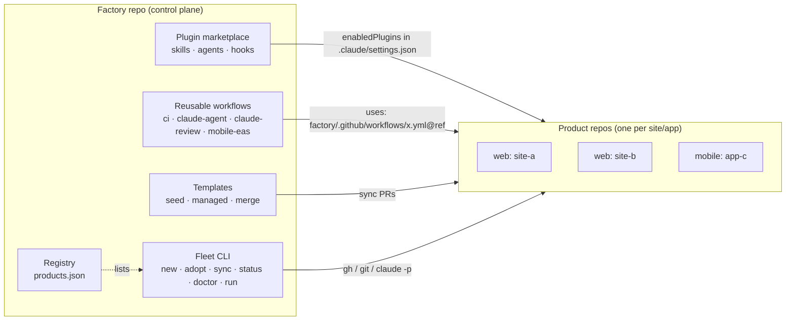

# The Software Factory Blueprint

A **software factory** here means one repeatable system that turns ideas into shipped changes across
_many_ products (websites and mobile apps, each in its own repo), with Claude Code doing most of the
work and you acting as operator, reviewer and decision-maker.

This document is the generalized outline. It stands on its own if you want to build your own version,
and the rest of this repo is one working implementation of it.

| Doc                                                          | What's in it                                                          |
| ------------------------------------------------------------ | --------------------------------------------------------------------- |
| [01-architecture.md](01-architecture.md)                     | Components, how they connect, and why it's built this way             |
| [02-setup.md](02-setup.md)                                   | One-time setup, step by step                                          |
| [03-feature-pipeline.md](03-feature-pipeline.md)             | Day-to-day: building features and fixes in a product                  |
| [04-fleet-operations.md](04-fleet-operations.md)             | Managing many repos: sync, fleet runs, status, upgrades               |
| [05-subscription-and-usage.md](05-subscription-and-usage.md) | Running all of this on a Pro/Max subscription                         |
| [06-guardrails.md](06-guardrails.md)                         | What stops Claude from doing damage, layer by layer                   |
| [07-customizing.md](07-customizing.md)                       | New product types, stacks, skills and agents, versioning              |
| [08-research-notes.md](08-research-notes.md)                 | Sources, patterns from other factories, Claude Code feature reference |

---

## 1. Principles

1. **One control plane, many products.** Keep one repo per product (polyrepo) and add one _factory_
   repo that holds the shared process. Don't merge products into a monorepo just to share tooling.
2. **Standardize the interface, not the implementation.** Every product exposes the same contract
   (a manifest of commands, the same pipeline, the same gates). The stacks can differ.
3. **Deterministic gates decide "done".** Lint, typecheck, tests and build, run by code, decide
   whether work passes. Claude does the work between the gates and never grades its own homework.
4. **Humans own the merge and the release.** How much Claude does on its own is a per-product dial.
   Merging, deploying to production and submitting to the app stores always stay human decisions.
5. **Distribute through the channels built for it.** Claude behaviour goes out as **plugins**, CI as
   **reusable workflows**, and files as **templates plus sync PRs**. Don't copy-paste between repos.
6. **Every change is a PR.** Factory changes reach products as pull requests, never as silent pushes.
   The same applies to Claude's work.
7. **Treat usage as a budget.** Subscription usage is shared and finite. Trigger automation on demand
   (a mention, a label, a command), not on every push.

## 2. The shape



## 3. Components (what you need, whatever you build it with)

| #   | Component                   | Purpose                                                                                   | This repo's implementation                                                                |
| --- | --------------------------- | ----------------------------------------------------------------------------------------- | ----------------------------------------------------------------------------------------- |
| 1   | **Product contract**        | A machine-readable manifest each repo exposes: type, commands, CI checks, gates, autonomy | `.factory/product.json`                                                                   |
| 2   | **Shared standards**        | Engineering rules every product inherits, imported into each CLAUDE.md                    | `templates/common/managed/.factory/standards.md` → `@.factory/standards.md`               |
| 3   | **Shared Claude behaviour** | The pipeline as skills, specialist subagents, guardrail hooks                             | `plugins/factory`, `plugins/factory-web`, `plugins/factory-mobile` (a plugin marketplace) |
| 4   | **Shared CI**               | One definition of checks, Claude-on-GitHub and mobile builds                              | `.github/workflows/*.yml` (`on: workflow_call`)                                           |
| 5   | **Templates**               | The files every product gets, with clear ownership rules                                  | `templates/{common,web,mobile}/{seed,managed,merge}`                                      |
| 6   | **Registry**                | The list of products the factory manages                                                  | `registry/products.json`                                                                  |
| 7   | **Fleet tooling**           | Create, adopt, sync, inspect and batch-change products                                    | `scripts/factory.mjs`                                                                     |
| 8   | **Operator interface**      | You talking to Claude in the factory repo to run the fleet                                | `CLAUDE.md` + `.claude/skills/*` in this repo                                             |

## 4. The product contract

Everything keys off one file per product, so CI, hooks and skills never hard-code a stack:

```jsonc
// .factory/product.json
{
  "name": "acme-site",
  "type": "web",
  "framework": "next",
  "packageManager": "npm",
  "autonomy": "supervised", // supervised | standard | autonomous
  "commands": {
    "install": "npm ci",
    "lint": "npm run lint",
    "typecheck": "npx tsc --noEmit",
    "test": "npm run test",
    "build": "npm run build",
    "e2e": "",
  },
  "ci": ["lint", "typecheck", "test", "build"], // what CI and /factory:verify run
  "gates": { "onStop": ["lint", "typecheck"] }, // what Claude must pass before it stops
  "deploy": { "provider": "vercel", "productionBranch": "main" },
}
```

## 5. Lifecycle of a product

1. **Create** (`factory new`) or **adopt** (`factory adopt`). The repo gets the manifest, standards,
   CI, Claude workflows, issue and PR templates, and plugin settings.
2. **Onboard** (`/factory:onboard`). Claude checks the manifest's commands actually work and fills
   in the product's CLAUDE.md from the real code.
3. **Build** (`/factory:feature`, `/factory:bugfix`, `@claude` on an issue). Spec → plan → build →
   verify → review → PR. A human merges.
4. **Release.** Web deploys through the host's Git integration (preview per PR, production on
   merge). Mobile goes through `/factory-mobile:ota` (JS-only changes) or `/factory-mobile:release` (store builds).
5. **Maintain** (`factory sync`, `factory run`, `factory status`/`doctor`). Standards updates, dependency
   upgrades and cross-fleet changes arrive as PRs.
6. **Retire.** Set `status: archived` in the registry and fleet commands skip the product.

## 6. The pipeline and its gates

| Stage  | Output                                                      | Gate (who/what decides it's done)                            |
| ------ | ----------------------------------------------------------- | ------------------------------------------------------------ |
| Spec   | `docs/specs/NNNN-slug.md` with testable acceptance criteria | Human approval (`supervised`/`standard`), or at PR review    |
| Plan   | `NNNN-slug.plan.md`: files, steps, AC → test mapping        | Human approval (`supervised`), or at PR review               |
| Build  | Small commits, tests first                                  | Stop gate: `gates.onStop` must pass before Claude stops      |
| Verify | All `ci` commands green                                     | `verify.mjs` exit code, then CI                              |
| Review | Severity-ranked findings vs spec and standards              | `reviewer` subagent locally, optional Claude PR review in CI |
| Ship   | PR with spec, plan, evidence, risk and rollback             | **Human merge** (hooks block Claude from merging)            |

## 7. Maturity roadmap: build it in this order

| Level                   | You have                                                                                                                         | Typical timeline                      |
| ----------------------- | -------------------------------------------------------------------------------------------------------------------------------- | ------------------------------------- |
| **1. Foundations**      | Factory repo, registry, a manifest + CLAUDE.md + standards in every product, the core plugin used interactively                  | Day 1                                 |
| **2. Automated gates**  | Reusable CI on every product, guard and stop-gate hooks, PR and issue templates, `@claude` on GitHub                             | Week 1                                |
| **3. Fleet operations** | Sync PRs, fleet runs, status/doctor, opt-in Claude PR review, scheduled maintenance (cloud scheduled tasks)                      | Weeks 2-4                             |
| **4. Earned autonomy**  | `autonomous` mode for low-risk products, label-driven issue → PR, scheduled audits and dependency runs, metrics on PR acceptance | Once levels 1-3 are boringly reliable |

Move a product up a level only when the level below has been quiet (no surprises) for a while.

## 8. Key decisions and recommended defaults

| Decision                | Recommendation                                          | Why                                                                                                               |
| ----------------------- | ------------------------------------------------------- | ----------------------------------------------------------------------------------------------------------------- |
| Monorepo vs polyrepo    | **Keep polyrepo** + a factory repo                      | Your products are independent. Plugins, reusable workflows and sync PRs give you the sharing without the coupling |
| Factory repo visibility | **Public** (it holds process, not product code)         | Private repos need an Actions access policy, and CI can't install plugins from a private marketplace              |
| GitHub account          | A **free GitHub organization** for products             | Org-level Actions secrets (set the token once), org rulesets, one Claude App install                              |
| Default web stack       | Next.js (configurable in `templates/web/template.json`) | Most common, well supported by Claude. Astro or Vite are a one-line change                                        |
| Default mobile stack    | Expo + EAS                                              | One codebase for iOS and Android, cloud builds without a Mac, OTA updates                                         |
| Default autonomy        | `supervised`                                            | Earn trust per product, then dial up                                                                              |
| CI model                | `sonnet` (repo variable override)                       | Preserves subscription usage. Use Opus interactively for hard work                                                |
| Claude PR review        | Opt-in (`claude-review` label)                          | Reviewing every PR burns usage. Turn on `FACTORY_AUTO_REVIEW` per repo if it earns its keep                       |
